 

---

## 👨‍💻 About Me | عني

🚀 **Web & Bots Developer** — بحوّل الأفكار لمنتجات ذكية وسريعة وشكلها حلو.

💡 I love building clean, fast and smart web experiences.

🌱 Always learning, always shipping.

---

## 🛠️ Tech Stack

  

---

## 🌐 Portfolio

---

## 📬 Contact | تواصل معي

